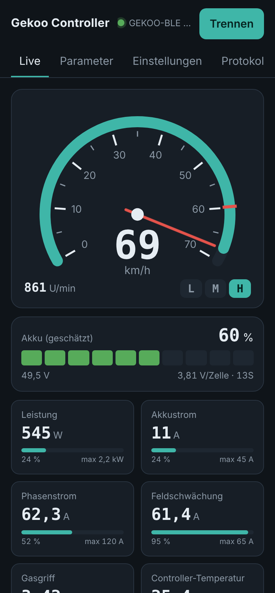
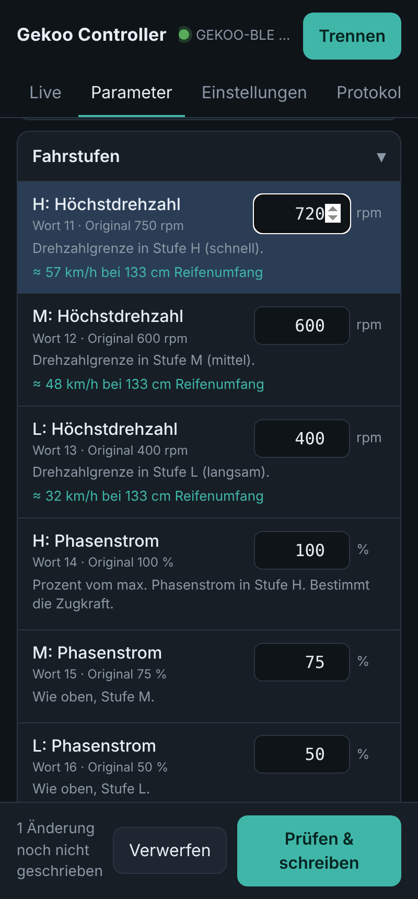
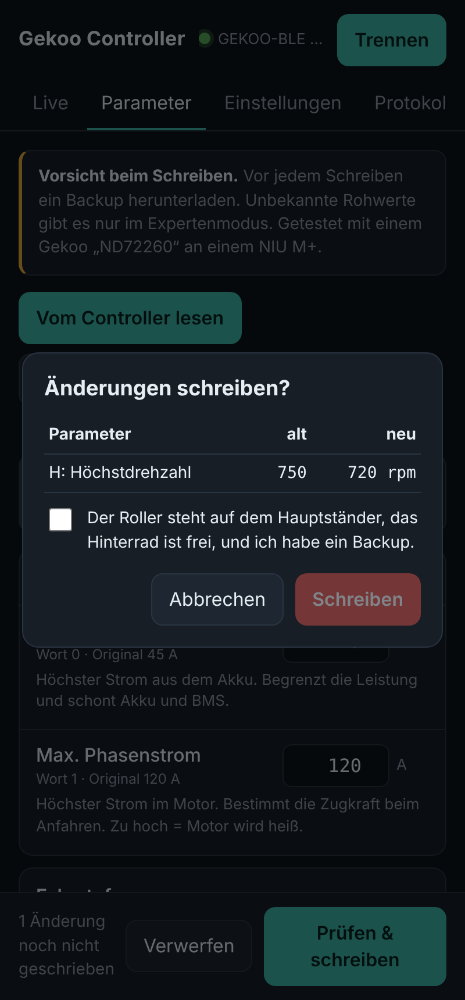
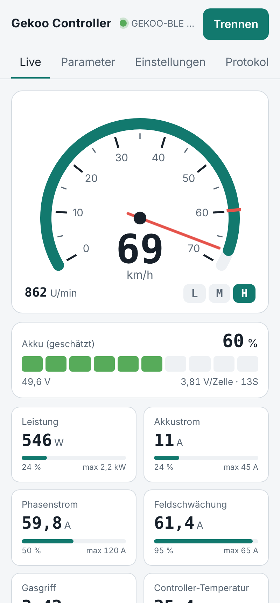
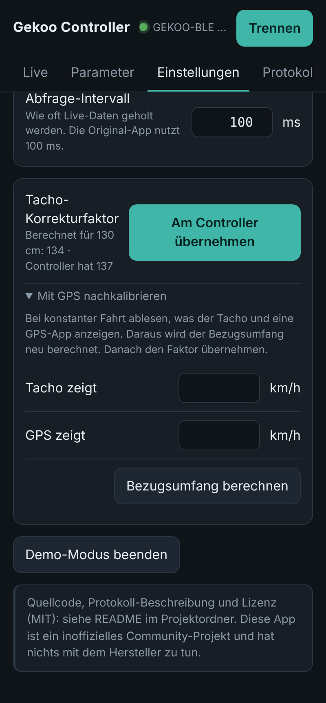

# Gekoo Controller – offene Web-App

Deutschsprachige Open-Source-Alternative zur chinesischen WeChat-Mini-App „BLE Tool“ für
**Gekoo-Motorcontroller** (Fardriver-artig, Bluetooth-Name `GEKOO-BLE`, getestet mit Typ ND72260 an einem NIU M+).

*English: open-source web app (Web Bluetooth) to monitor and configure GEKOO-BLE motor controllers.
Protocol documented in [PROTOCOL.md](PROTOCOL.md).*

**Sofort ausprobieren:** [Web-App öffnen](https://hanneshoerti.github.io/gekoo-ble-tool/) (Chrome auf Android/PC) ·
[Demo ohne Roller](https://hanneshoerti.github.io/gekoo-ble-tool/#demo) ·
**Android-App:** [neueste APK unter Releases](https://github.com/hanneshoerti/gekoo-ble-tool/releases/latest)


<p align="center">
  
  
  
</p>
<p align="center">
  
  
</p>
<p align="center"><sub>Aufgenommen im Demo-Modus mit echten Messdaten eines NIU M+ (Stufe H, Feldschwächung aktiv).</sub></p>

## Was sie kann

- **Live:** analoger Tacho (km/h aus Reifenumfang, rote Marke am Limit von Stufe H), Drehzahl, Gang,
  Akku-Tankanzeige (geschätzt über die NMC-Zellkurve), Prozentbalken für Leistung, Akkustrom, Phasenstrom,
  Feldschwächung, Gasgriff und Temperatur, dazu 12 V und Fehlercode
- **AutoConnect** beim Start (Android-App) und automatisches Neuverbinden, z. B. nach „Zündung aus/an“
- **Tacho-Faktor** wird aus dem Reifenumfang berechnet und auf Wunsch am Controller übernommen,
  mit GPS-Nachkalibrierung
- **Parameter:** lesen, verständlich auf Deutsch erklärt, ändern, mit Prüfsumme schreiben und zur Kontrolle
  zurücklesen. Vor dem Schreiben gibt es eine Übersicht aller Änderungen und Warnungen bei riskanten Werten.
- **Backup** als JSON herunterladen und wiederherstellen
- **Protokoll-Log** für Fehlersuche und zum Weiterentschlüsseln
- **Demo-Modus** ohne Roller: `index.html#demo` (simulierter Controller mit echten Messdaten)

## Für welche Fahrzeuge?

Die App spricht mit dem **Gekoo-Controller**, nicht mit dem Fahrzeug. Protokoll und Parameter-Beschriftungen
gelten deshalb für jedes Fahrzeug mit diesem Controller. Getestet ist bisher ein **Gekoo ND72260 an einem NIU M+ Lite**.
Andere Gekoo-Typen oder Firmware-Versionen können abweichen. Rückmeldungen gerne als Issue.

Fahrzeugabhängig sind nur diese Einstellungen (Reiter „Einstellungen“, die App weist beim ersten Start darauf hin):

| Einstellung | Standard (NIU M+) | Wofür |
|---|---|---|
| Reifenumfang | 133 cm | km/h-Anzeige, km/h-Hinweise bei den Drehzahlgrenzen |
| Akku-Zellen in Reihe | 13 (48 V) | Akkuanzeige und Warnungen beim Schreiben (16 = 60 V, 20 = 72 V) |
| Tacho-Bezugsumfang | 97,1 cm | Tacho-Korrekturfaktor; mit „GPS nachkalibrieren“ für jedes Fahrzeug bestimmbar |

## Benutzen

Web Bluetooth braucht **Chrome auf Android oder am Computer** (Windows, macOS, Linux) und eine
`https://`-Adresse oder `localhost`. Auf dem iPhone geht es nur mit einem Browser wie „Bluefy“.

**Am einfachsten:** <https://hanneshoerti.github.io/gekoo-ble-tool/> in Chrome öffnen.
Für eine eigene Kopie: Repository forken, Settings → Pages → Branch `main` / Ordner `/`.

**Lokal zum Testen:**
```
python3 -m http.server 8000
# Browser: http://localhost:8000/        (Demo: http://localhost:8000/#demo)
```

**Als Android-App (APK):** Ordner `android/` in Android Studio öffnen und bauen, siehe unten.
Die App enthält dieselbe Oberfläche, nutzt aber direkt das Bluetooth von Android (die WebView kann kein Web Bluetooth).
Sie funktioniert offline, Android 10 oder neuer.

Wichtig: Die WeChat-App muss geschlossen sein, weil der Controller nur eine Verbindung gleichzeitig annimmt.

## Android-App bauen

Fertige APKs baut GitHub Actions automatisch (Reiter „Actions“ bzw. bei Versionen unter „Releases“).
Selbst bauen:

1. Android Studio → **Open** → den Ordner `android` auswählen (nicht den Hauptordner).
2. Warten, bis „Gradle Sync“ fertig ist. Schlägt Android Studio ein Update des Android Gradle Plugins vor, darf man zustimmen.
3. Handy per USB verbinden (USB-Debugging an) und oben auf **Run ▶** klicken, oder
   **Build → Build App Bundle(s) / APK(s) → Build APK(s)**. Die APK liegt dann in `android/app/build/outputs/apk/`.
4. Beim ersten Verbinden fragt die App nach der Berechtigung „Geräte in der Nähe“, bitte erlauben.

Alle Builds werden mit dem Schlüssel `android/signing.keystore` signiert (absichtlich öffentlich), damit
Updates zwischen selbst gebauten und GitHub-APKs ohne Deinstallieren klappen.

Nach Änderungen an `index.html` oder `gekoo.js` vor dem Bauen `android/sync-web.sh` (bzw. `sync-web.bat`)
ausführen. Damit werden die Dateien nach `android/app/src/main/assets/www/` kopiert.

Aufbau: `MainActivity.java` zeigt die Oberfläche in einer WebView und stellt über `window.GekooNative`
Suchen, Verbinden, Benachrichtigungen und Schreiben bereit. `android-bridge.js` baut daraus
`navigator.bluetooth`, sodass die Oberfläche unverändert läuft. Backups landen in `Download/Gekoo`.

## Sicherheit

Das ist ein inoffizielles Community-Projekt ohne Verbindung zum Hersteller. Falsche Parameter können
Motor, Controller oder Akku beschädigen. Nicht alle Felder sind sicher zugeordnet (siehe PROTOCOL.md).
Immer erst ein Backup machen, nur auf dem Hauptständer testen, und Änderungen an Leistung oder
Höchstgeschwindigkeit müssen zur Zulassung deines Fahrzeugs passen.

## Entwicklung

```
npm test                      # spielt einen echten Mitschnitt durch das Protokoll-Modul
node test/bridge.test.cjs     # Android-Brücke mit gefälschter nativer Seite (Server auf :8766 im Ordner android/app/src/main/assets/www)
node test/live.test.cjs       # Live-Ansicht, AutoConnect, Neuverbinden (Server auf :8765)
node test/tacho.test.cjs      # Reifenumfang → Tacho-Faktor → schreiben (Server auf :8765)
node test/e2e.test.cjs        # Browser-Test gegen den simulierten Controller (braucht Playwright + laufenden Server auf :8765)
node tools/make-demo-data.js  # demo-data.js aus dem Mitschnitt neu erzeugen
python3 tools/btsnoop_decode.py btsnoop_hci.log > session.txt
```

| Datei | Inhalt |
|---|---|
| `gekoo.js` | Protokoll: Frame-Parser, Live-Decoder, Parameter, Prüfsumme |
| `index.html` | Oberfläche |
| `android-bridge.js` | `navigator.bluetooth` für die Android-App |
| `android/` | Android-Studio-Projekt (WebView + native Bluetooth-Brücke) |
| `mock-device.js`, `demo-data.js` | simulierter Controller |
| `PROTOCOL.md` | Protokollbeschreibung |
| `test/` | Tests und Mitschnitt |

Lizenz: MIT
